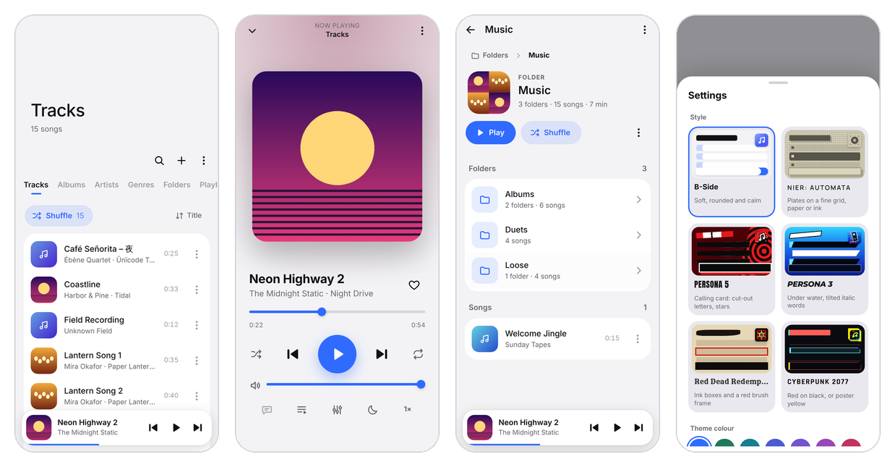
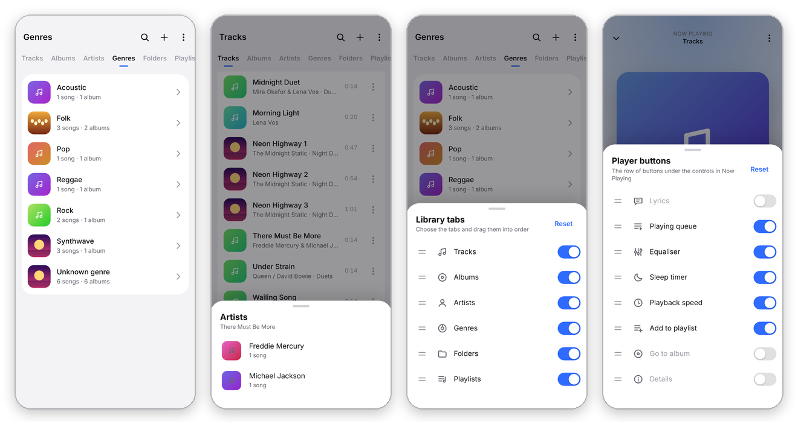
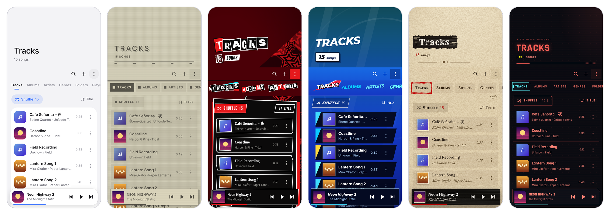
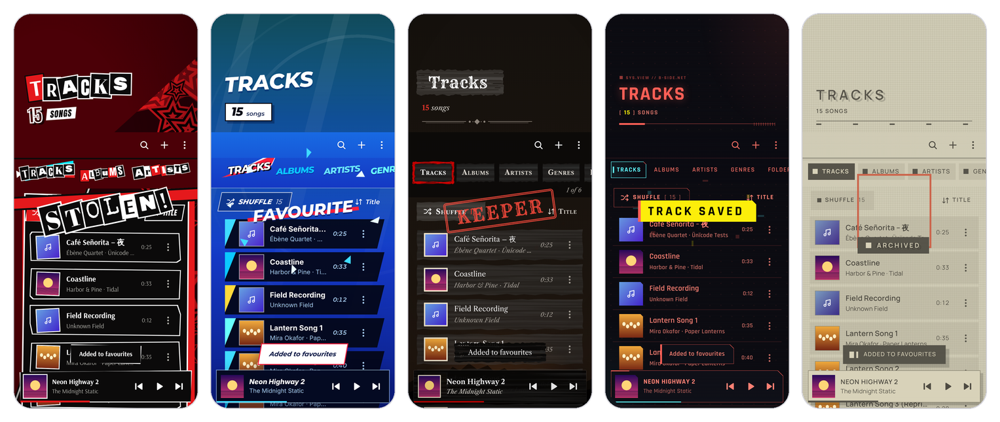
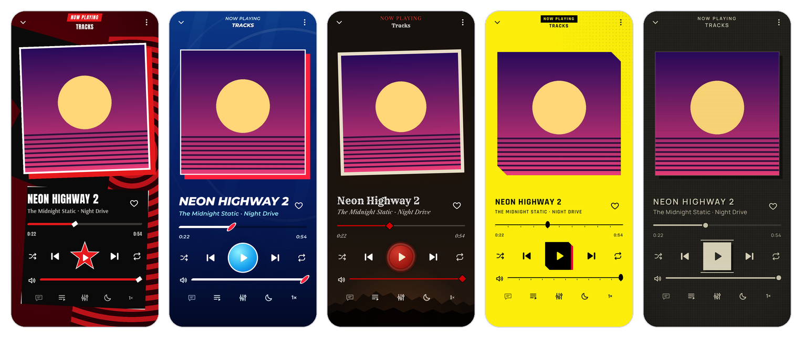
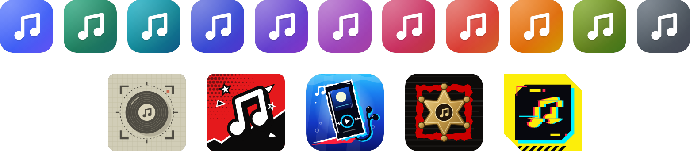
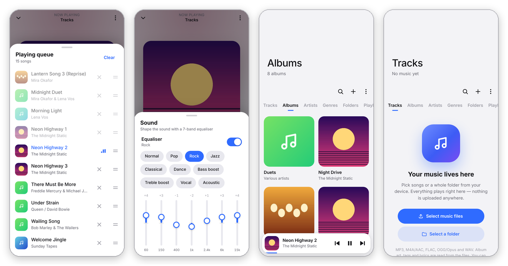
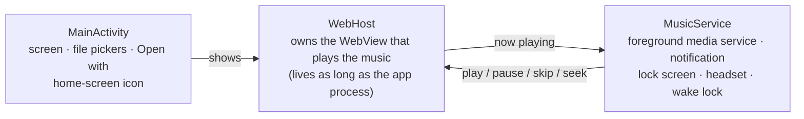

<h1 align="center">B-Side</h1>

<p align="center">
  <b>A local music player for the songs you already own.</b><br>
  Pick files or whole folders, and B-Side plays them on your device: six distinct looks, sound effects to match,<br>
  and not a single byte uploaded anywhere.
</p>

<p align="center">
  
  
  
</p>

<p align="center">
  
</p>

B-Side comes in two forms built from the same code: a **single HTML file** (about 900 KB, fonts included) that runs in any modern
browser, and an **Android app** (about 1 MB) that wraps it with the things a phone music player needs: playback that
keeps going after you close the app, a media notification, lock-screen and headset controls, and the system file pickers.

---

## Features

### Library
- **Tracks, Albums, Artists, Genres, Folders and Playlists** tabs, with search and sorting by title, artist, album, date added or duration. **Choose which tabs appear and drag them into any order.** Long-press the tab bar, or go to *Settings → Library tabs*.
- **Songs with several singers count for each of them.** "Freddie Mercury & Michael Jackson" appears under both artists, and *Go to artist* lets you pick which one. B-Side reads multi-artist tags (ID3v2.4 lists, `ARTISTS`, repeated Vorbis `ARTIST` fields) and can split names on `&`, commas, `feat.`/`ft.`, `;`, `/`, `x`, `and`, `with`, `vs.` and `+`, each of which you can switch on or off. A never-split list keeps names like *AC/DC*, *Simon & Garfunkel* and *Earth, Wind & Fire* whole, and "& The …" backing bands stay together.
- **Genres** are split the same way, so a song tagged "Pop/Rock" appears under both Pop and Rock.
- **Folders work like a file explorer.** Only the folders you added sit at the top level; tap through to subfolders and songs, with a breadcrumb path to jump back up. Playing or shuffling a folder plays everything inside it.
- **Albums your way.** Choose where the album artist appears: *On albums* (under album names), *Everywhere* (also on songs, in the player and the notification, as "Album artist – Album" when it differs from the singer) or *Nowhere* (albums show their singers instead). Switch off *Separate albums by album artist* to keep every song with the same album title in one album. With it on, songs missing an album-artist tag still join their album when it's in the same folder. Find both in *Settings → Albums*.
- **Smart playlists** (Favourites, Recently added, Most played, Recently played) alongside your own playlists.
- **Reads everything from the files:** title, artist, album, album artist, track and disc numbers, year, genre, cover art and lyrics. It also picks up `cover.jpg` / `folder.jpg` and matching `.lrc` lyric files in a folder.

### Player
- A mini player and a full **Now Playing** screen tinted from the album art. Swipe the cover to skip and drag down to close.
- **Playing queue** with drag to reorder, plus *Play next* and *Add to queue* from any song, album, artist, folder or playlist.
- Shuffle, repeat all and repeat one.
- **Volume levelling** plays every song at about the same loudness, so a quiet song after a loud one doesn't need the volume turned up. Level *Each song* (best for playlists and shuffle) or by *Album* (keeps a quiet intro quiet), at *Quieter*, *Normal* or *Louder*. B-Side uses ReplayGain and Opus R128 tags when your files have them. It measures other songs on the device, the EBU R128 way, just before they first play, and saves the result. It never raises a song so far that its peaks distort. Turn it on from the Sound button in Now Playing or *Settings → Volume levelling*.
- **7-band equaliser** (60 Hz – 15 kHz) with 10 presets: Normal, Pop, Rock, Jazz, Classical, Dance, Bass boost, Treble boost, Vocal and Acoustic.
- **Sleep timer** (15 min to 1 h 30 min, or at the end of the current song) that fades the music out.
- **Playback speed** from 0.5× to 2×.
- **Lyrics view** for plain lyrics and time-synced `.lrc` lyrics. Synced lines highlight as the song plays; tap a line to jump to it.
- **Choose your player buttons.** Pick which buttons sit under the controls and drag them into order: Lyrics, Playing queue, Sound (equaliser and volume levelling), Sleep timer, Playback speed, Add to playlist, Go to album and Details. Long-press the row, or use *Settings → Player buttons*. Hidden ones stay one tap away in the ⋮ menu.

<p align="center"></p>

### Styles, sound and colour
<p align="center"></p>

Each style is a whole design language borrowed from a game's menus, not a colour swap: its own type, shapes, the way a
chosen item looks, motion, sounds and app icon. Every page and feature stays the same. The styles follow the
[game UI theme guide](docs/STYLES.md#the-method) from [Checkmate](https://github.com/TymonBitesTheDust/Checkmate), and
[docs/STYLES.md](docs/STYLES.md) has the style sheet for each one.

| Style | Look | Chosen item | Light / dark |
|---|---|---|---|
| **B-Side** | Soft, rounded and calm, in your choice of theme colour | Accent underline | Light and dark |
| **NieR: Automata** | YoRHa menus: beige paper on a fine grid, light-brown plates with square markers, scanlines | The plate fills dark from the left while thin lines slide out above and below | Paper and Ink |
| **Persona 5** | The calling card: blood red, a field of pulsing star ripples, cut-out ransom letters, jagged black plates with white edges | A red and cyan highlight wiggling behind it | Always dark |
| **Persona 3 Reload** | The pause menu under water: drifting caustics and light rays, a tilted stack of italic command words, the page name on a white ribbon on wide screens | White, on a red and white triangle cursor | Surface and Depths |
| **Red Dead Redemption 2** | Native menus: every option on its own ink box, titles in a black brush banner, a "2 of 6" counter | A rough red brush frame | Journal (paper) and Campfire (night) |
| **Cyberpunk 2077** | Settings menus: salmon red on near-black, cut corners, tick marks, bracketed counts, ‹ ON › switches | A cyan cut-corner frame | Neon (dark) and Yellow (street poster) |

- **Every style moves its own way** when you change page: Persona 5 sweeps a red wipe and shakes the screen, Persona 3 ripples rings out, Red Dead sweeps an ink brush across, Cyberpunk slices and flickers, and NieR's titles glitch into place.
- **Liking a song is a moment.** Add a song to your favourites and Persona 5 stamps *Stolen!* across the screen, Persona 3 breaks glass with *FAVOURITE*, Red Dead stamps a red *KEEPER*, Cyberpunk flickers in *TRACK SAVED*, and NieR's square locks on.
- **Persona 5 has its own settings**: it's always dark, so *Settings* swaps the light/dark choice for *Animations* (Match device, Full or Reduced) and *Show the star field*. Every style respects your device's reduced-motion setting.
- **Sound effects** synthesized live, with a different bank for each style: Persona 5's square-wave blips, whoosh and kick; Persona 3's glassy bells and bubbles; NieR's terminal blips; Red Dead's plucked guitar, register bell and rubber stamp; Cyberpunk's digital blips, saw zaps and sub drops. Choose *Off*, *Actions* or *Everything* (adds a soft tick as you move through menus) and set the volume. The effects never pass through the music equaliser.
- **Theme colour** for the B-Side style: 11 colours or any colour code. Colours are adjusted for readable text in light and dark mode.
- **The app icon follows the style and colour**: the browser tab icon on the web, and the home-screen icon on Android. Each game style has its own icon drawn from its game: a YoRHa record under a lock-on reticle (NieR), a big white note slashed across red and black (Persona 5), a brush-ink pocket music player under water (Persona 3), a brass lawman's star in the rough red frame (Red Dead) and a glitching note on street-poster yellow (Cyberpunk).

<p align="center"></p>
<p align="center"></p>
<p align="center"></p>

### On Android
- **Keeps playing after you close the app**, whether you press Home or Back or swipe it out of Recents. Controls stay in the notification, on the lock screen, and on headsets and Bluetooth devices.
- **Built for long listening sessions.** After a pause, B-Side stays in the foreground for 45 minutes so Android doesn't close it between songs. *Settings → Background playback* shows whether Android's battery optimisation might close it, and lets you exempt B-Side in one tap. On Samsung phones it also points you to *Background usage limits*.
- Pauses automatically when headphones are unplugged.
- Uses the system **file and folder pickers**, and shows up as **"Play with B-Side"** when you open or share audio from a file manager.
- Draws edge to edge and follows the system's dark mode.

### Private by design
No accounts, no ads, no analytics and no network requests. Songs you add are copied into B-Side's own storage on your
device so your library is still there next time. You can switch that off in *Settings → Library*. Removing a song from
B-Side never touches the original file.

<p align="center"></p>

---

## Get B-Side

### Android
1. Download **`B-Side.apk`** from the [latest release](../../releases/latest).
2. Open it on your phone and allow *Install unknown apps* when asked. Play Protect may warn you because the app isn't from the Play Store.

Needs Android 7.0 or newer.

### Web
Open **`web/index.html`** in Chrome, Edge, Firefox or Safari. There's nothing to install, and it works offline.

To host it on **GitHub Pages**, copy `web/index.html` to `docs/index.html` and set *Settings → Pages* to deploy from
the `docs` folder of your main branch.

> Picking a whole folder needs a desktop browser or the Android app. On desktop you can also drag files and folders onto the window.

---

## Using B-Side

| To… | Do this |
|---|---|
| Add music | Tap **+** → *Select music files* or *Select a folder* |
| Open a song's options | Tap its **⋮**, or right-click / long-press the song |
| Change style, colour, sounds or theme | **⋮** in the top-right corner → *Settings* |
| Show, hide or reorder tabs | Long-press the tab bar (right-click on desktop) |
| Choose the player buttons | Long-press the button row in Now Playing, or ⋮ → *Customise buttons* |
| Fix how an artist is split | *Settings → Artists*: switch separators on or off, or add the name to *Never split* |
| Even out loud and quiet songs | Now Playing → Sound button → *Volume levelling* |
| Stop an album splitting in two | *Settings → Albums* → switch off *Separate albums by album artist* |
| Skip from Now Playing | Swipe the album cover left or right |
| Reorder the queue | Now Playing → queue button → drag the handle |

**Keyboard shortcuts** (web)

| Key | Action |
|---|---|
| <kbd>Space</kbd> | Play / pause |
| <kbd>←</kbd> / <kbd>→</kbd> | Seek 5 seconds |
| <kbd>Shift</kbd> + <kbd>←</kbd> / <kbd>→</kbd> | Previous / next song |
| <kbd>/</kbd> | Search |
| <kbd>Esc</kbd> | Close or go back |

### Supported formats
MP3, M4A/AAC, FLAC, Ogg Vorbis, Opus and WAV (plus WebM audio). Whether a format plays depends on the browser or
Android's built-in browser engine. Android plays all of these, but some Linux browser builds can't decode AAC.

Tags are read by B-Side's own parser, with no third-party libraries: ID3v1 and ID3v2.2–2.4 (including embedded art and
lyrics), Vorbis comments in FLAC, Ogg and Opus files, MP4/M4A metadata, and RIFF INFO in WAV files. Loudness comes
from `REPLAYGAIN_*` tags (ID3 `TXXX`, Vorbis comments, MP4 freeform atoms), Opus `R128_*_GAIN`, or iTunes Sound Check
(`iTunNORM`) as a fallback.

---

## Build from source

### Web
```bash
python3 web/build.py        # web/app.html + fonts.css + skins/ + skins.js + icons.js → web/index.html
```
Edit `web/app.html` (the player), `web/skins/*.css` and `web/skins.js` (the game styles), `web/icons.js` (the app icons)
or `web/fonts.css` (style fonts), then rebuild.

### Android
B-Side builds **without Gradle or Android Studio**. You need:

- **JDK 17** or newer, and **Python 3**
- A folder of tools (set `TOOLS` to its path):
  - `aapt2`, `lib/d8.jar` → `d8.jar` and `lib/apksigner.jar` → `apksigner.jar` from Android SDK **build-tools 34**
  - `android.jar` from the Android SDK **platforms/android-34**
  - `ecj.jar`: the Eclipse Java compiler (`org.eclipse.jdt:ecj` on Maven Central)
- For regenerating launcher icons only: **Playwright** with Chromium, and **Pillow**

```bash
python3 web/build.py                 # 1. build the player
python3 android/gen_icons.py         # 2. only after changing web/icons.js (generated icons are committed)
export TOOLS=/path/to/tools
export KS_PASS='your-key-password'
android/build.sh                     # 3. → android/build/B-Side.apk
```

The first build creates a signing key at `android/bside-release.jks` if there isn't one. **Keep that key private and
back it up.** It is excluded by `.gitignore`, and every update must be signed with the same key to install over an
existing copy of B-Side.

---

## How it works

The whole player is one web page. Audio plays through an HTML `<audio>` element, routed through Web Audio for the
equaliser and volume levelling. To measure a song without loudness tags, B-Side decodes it once with an
`OfflineAudioContext` and applies the ITU-R BS.1770 K-weighting with 400 ms gated blocks. Each song's level is then set
by one gain node. Tags are parsed in JavaScript. Your library and the copied song files live in IndexedDB, and settings in
`localStorage`.

The Android app is a small native shell, about 1,100 lines of Java:



- **`WebHost`** owns the WebView at process level rather than inside the screen. Closing B-Side, swiping it away or
  Android recycling the screen only detaches the view, so a song that's playing keeps playing. Reopening the app
  reattaches the same player, mid-song. When nothing is playing and no screen is open, the player is freed.
- **`MusicService`** is a `mediaPlayback` foreground service. It mirrors the player into a `MediaSession` and
  notification, holds a wake lock while music plays so the next song starts on time with the screen off, and pauses
  when headphones are unplugged. After a pause it stays in the foreground for 45 minutes before letting Android
  reclaim the app.
- **`MainActivity`** serves the page from the app's assets at `https://appassets.androidplatform.net/`. It handles the
  Storage Access Framework pickers, keeping read access to picked songs, and "Open with". It switches the home-screen
  icon by enabling one of 16 `<activity-alias>` entries, and only while the app is in the background and not playing.

### Project structure
```
b-side/
├── web/
│   ├── app.html          the player: markup, base styles and code
│   ├── skins/            one CSS file per game style, every rule scoped to [data-skin="…"]
│   ├── skins.js          style-only pieces: cut-out letters, star field, ribbon, page changes
│   ├── icons.js          app icon generator (tab icon, settings previews, launcher icons)
│   ├── fonts.css         display fonts for the styles (embedded, works offline)
│   ├── build.py          builds the single-file player
│   └── index.html        built player, ready to open or ship
├── android/
│   ├── AndroidManifest.xml
│   ├── src/app/bside/music/
│   │   ├── MainActivity.java
│   │   ├── WebHost.java
│   │   └── MusicService.java
│   ├── res/              hand-made resources (strings, theme, notification icons)
│   ├── res-gen/          launcher icons generated by gen_icons.py
│   ├── gen_icons.py
│   ├── zipalign.py
│   └── build.sh
└── docs/
    ├── STYLES.md         the style sheet for each game style
    └── screenshots/
```

---

## Credits
- Fonts: Anton, Arsenal, Abril Fatface, Bowlby One, Rubik Mono One and Special Elite (Persona 5), Montserrat
  (Persona 3), Manrope (NieR: Automata), Rye and Libre Caslon Text (Red Dead Redemption 2) and Rajdhani (Cyberpunk
  2077), all under the [SIL Open Font License 1.1](https://openfontlicense.org), via
  [Fontsource](https://fontsource.org) and Google Fonts.
- The style designs follow the game UI theme guide written for
  [Checkmate](https://github.com/TymonBitesTheDust/Checkmate) (MIT), and reuse its drawn textures, brush shapes and
  sound recipes. No game logos, art, sound files or commercial fonts are used: every texture is CSS or inline SVG,
  and every sound is synthesized.
- The NieR: Automata, Persona 5, Persona 3, Red Dead Redemption 2 and Cyberpunk 2077 styles are fan-made tributes.
  B-Side is not affiliated with or endorsed by those games' publishers, and the names are trademarks of their
  respective owners.
