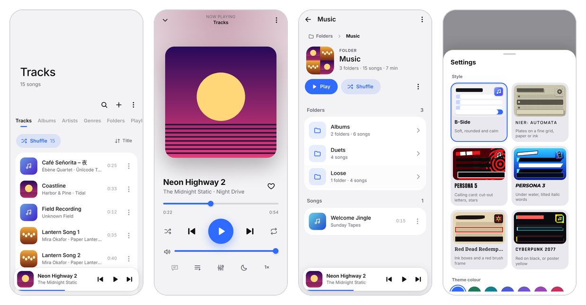
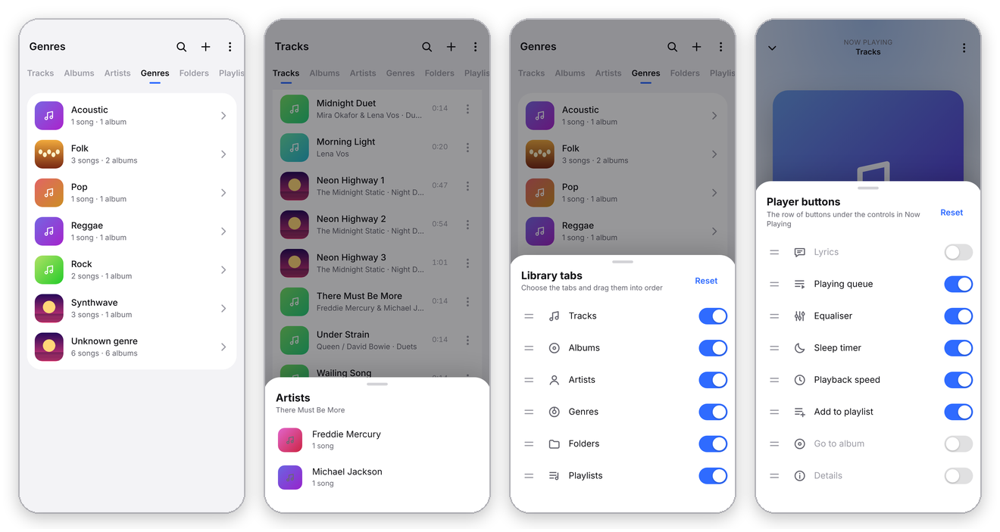
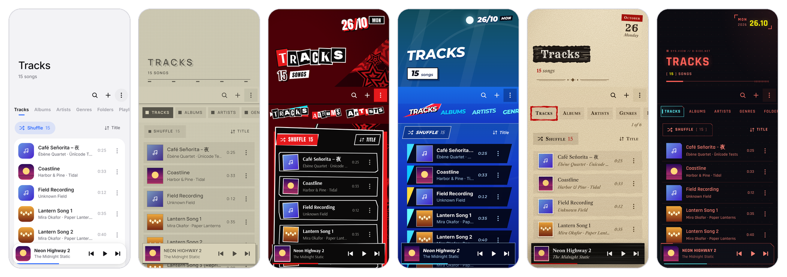
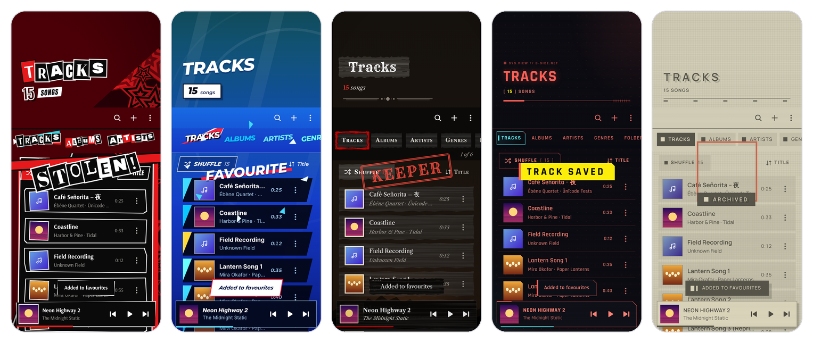
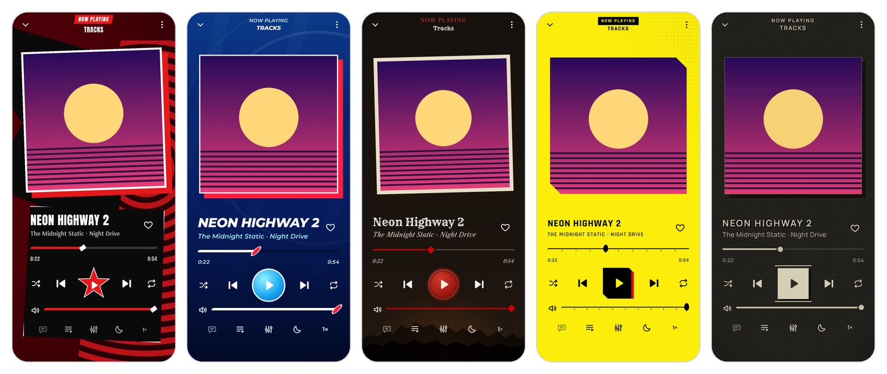
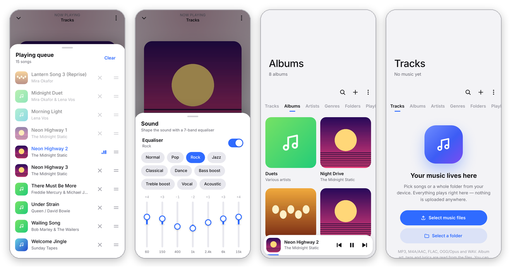

<h1 align="center">B-Side</h1>

  <b>A music player for the songs you already own.</b> 
  Pick songs or whole folders and B-Side plays them on your phone or computer, in six distinct looks with sound effects to match. 
  Your music is never uploaded anywhere.

  
  
  

  

---

## Get B-Side

### On your Android phone
1. Download **`B-Side.apk`** from the [latest release](../../releases/latest).
2. Open it and allow *Install unknown apps* when your phone asks. Play Protect may warn you because B-Side isn't from the Play Store; choose *Install anyway*.

Needs Android 7.0 or newer. To update, install the new `B-Side.apk` over the old one: your songs and playlists stay. Most updates also arrive by themselves the next time you open B-Side (*Settings → Update automatically*).

### On your computer
- **Download `B-Side.html`** from the [latest release](../../releases/latest) and double-click it. It opens in Chrome, Edge, Firefox or Safari, works offline, and there's nothing to install.
- **Or use it online** at **https://tymonbitesthedust.github.io/B-Side/**. Your music still stays on your computer: the page only plays the files you pick.

On a computer you can also drag songs and folders straight onto the window.

### First steps
1. Tap **+** and choose *Select music files* or *Select a folder*.
2. Tap a song to play it. Tap the mini player at the bottom to open **Now Playing**.
3. Tap **⋮** in the top-right corner, then **Settings**, to pick a style, colour, sound effects and more.

---

## What B-Side does

### Your library
- **Tracks, Albums, Artists, Genres, Folders and Playlists**, with search, and sorting by title, artist, album, date added or length. Choose which tabs show and drag them into any order: long-press the tab bar, or *Settings → Library tabs*.
- **Songs with several singers count for each of them.** "Freddie Mercury & Michael Jackson" shows under both artists. Bands like *AC/DC* and *Simon & Garfunkel* stay whole, and you can fine-tune this in *Settings → Artists*.
- **Genres** like "Pop/Rock" show under both Pop and Rock.
- **Folders work like a file explorer**, with a path at the top to jump back up. Playing a folder plays everything inside it.
- **Albums your way**: choose where the album artist shows, and whether albums with the same name but different artists stay apart (*Settings → Albums*).
- **Fast scroll** for long lists (*Settings → Fast scroll*): a **Scrollbar** you drag on the right edge, or **A–Z** letters you tap or slide along to jump to the first song, album or artist starting with that letter.
- **Smart playlists**: Favourites, Recently added, Most played and Recently played, next to your own playlists.
- **Everything comes from your files**: titles, artists, albums, cover art and lyrics, including `cover.jpg` / `folder.jpg` pictures and `.lrc` lyric files in the same folder.

### The player
- A mini player and a full **Now Playing** screen tinted by the album art. Swipe the cover to skip, drag down to close.
- **Playing queue**: drag to reorder, and *Play next* or *Add to queue* from any song, album, artist, folder or playlist.
- Shuffle, repeat all and repeat one.
- **Volume levelling** plays every song at about the same loudness, so you don't reach for the volume between a quiet song and a loud one.
- **7-band equaliser** with 10 presets (Pop, Rock, Jazz, Bass boost, Vocal and more).
- **Sleep timer** from 15 minutes to 1 hour 30, or at the end of the song. The music fades out.
- **Playback speed** from 0.5× to 2×.
- **Lyrics**, including time-synced lyrics that follow the song; tap a line to jump to it.
- **Open in Spotify** from any song, album or artist, to find it on Spotify.
- **Choose your player buttons**: long-press the button row in Now Playing, or *Settings → Player buttons*.

### Six styles

Each style changes the whole look and feel, not just the colours: the type, shapes, motion, sound effects and app icon. Choose one in *Settings*.

| Style | Look | Light / dark |
|---|---|---|
| **B-Side** | Soft, rounded and calm, in your choice of 11 colours or any colour code | Light and dark |
| **NieR: Automata** | Beige paper on a fine grid, light-brown plates, scanlines | Paper and Ink |
| **Persona 5** | Blood red with pulsing stars, cut-out ransom letters, jagged black plates | Always dark |
| **Persona 3 Reload** | The pause menu under water, with drifting light and tilted italic words | Surface and Depths |
| **Red Dead Redemption 2** | Ink boxes, black brush banners and a rough red frame | Journal and Campfire |
| **Cyberpunk 2077** | Salmon red on black, cut corners and cyan highlights | Neon and Yellow |

- **Every style moves its own way** when you change page, and **liking a song is a moment**: Persona 5 stamps *Stolen!*, Persona 3 breaks glass, Red Dead stamps *KEEPER*, Cyberpunk flickers *TRACK SAVED*, and NieR's square locks on.
- **Sound effects** made for each style. Choose *Off*, *Actions* or *Everything* and set the volume in *Settings*.
- **The app icon follows your style**, on the home screen and in the browser tab.
- Persona 5 has its own *Animations* setting, and every style follows your device's reduced-motion setting.

### On Android
- **Keeps playing after you close the app**, with controls in the notification, on the lock screen, and on headphones and Bluetooth devices.
- **Play from your car or headphones even when B-Side is closed.** Press Play and B-Side picks up your last song where you left off.
- **Pauses when headphones are unplugged.**
- **Updates itself.** New versions download in the background and start the next time you open B-Side.
- Shows up as **"Play with B-Side"** when you open a song from a file manager.

---

## Bring your Spotify playlists over

B-Side can't play songs from Spotify. Instead it turns your Spotify playlists and Liked Songs into B-Side playlists made of the **matching songs you've added to B-Side**, in Spotify's order. Songs you don't have are listed under *Not on this device*; tap one to find it on Spotify. Import again any time to update a playlist.

Open it from the **Playlists** tab → **Spotify**, or *Settings → Import from Spotify*. There are two ways:

### Way 1: Spotify data file (any account, even free)
1. On spotify.com, open **Account → Privacy settings → Download your data**, and request **Account data**.
2. Spotify emails you a file called `my_spotify_data.zip`. It can take a few days.
3. In B-Side, choose **Choose a file** and pick that zip. Your playlists and Liked Songs appear in the Playlists tab.

CSV files from Exportify or TuneMyMusic work too. Nothing goes online with this way.

### Way 2: Connect your Spotify account (needs Premium)
Spotify only lets apps read your account through a free "developer app" that you make once. Spotify requires its owner to have **Spotify Premium**.

**Set up once:**
1. Go to **[developer.spotify.com/dashboard](https://developer.spotify.com/dashboard)** and log in.
2. Choose **Create app**. Any name and description will do.
3. Under **Redirect URIs**, add exactly `http://127.0.0.1:43821/callback`, then tap **Add**.
4. Tick **Web API**, agree to the terms and **Save**.
5. Open the app's **Settings**. Copy the **Client ID**, and under **User Management** add your own name and Spotify email.
6. In B-Side, tap **Enter Client ID** and paste it.

**Connect on your phone:** tap **Connect to Spotify**, log in and tap **Agree**, then tap **Back to B-Side**. B-Side picks the sign-in up by itself.

**Connect on your computer:**
1. Tap **Connect to Spotify**. Spotify opens in a new tab: log in and tap **Agree**.
2. The tab then shows **"This site can't be reached"**. That's expected: the sign-in code is in the address bar.
3. Click the address bar once, and press **Ctrl + C** (Mac: Cmd + C) to copy the whole address. It starts with `http://127.0.0.1:43821/callback?code=`.
4. Back in B-Side, tap **Paste the address**, press **Ctrl + V**, then **Connect**. Do this within 10 minutes.

When it says **"Connected as [your name]"**, tap **Import all**, or one playlist.

| If B-Side says… | Do this |
|---|---|
| Spotify doesn't recognise the Client ID | Check the Client ID matches your Spotify app (*Change Client ID*) |
| The Redirect URI doesn't match | In your Spotify app's settings it must be exactly `http://127.0.0.1:43821/callback` |
| Spotify refused | The app's owner needs Premium, and your account must be under *User Management* |
| That sign-in had already been used or had run out | Tap *Connect to Spotify* again and paste the new address straight away |
| A playlist is greyed out | Spotify only shares playlists you made or collaborate on, not ones like Discover Weekly |

---

## How do I…

| To… | Do this |
|---|---|
| Add music | Tap **+** → *Select music files* or *Select a folder* |
| Open a song's options | Tap its **⋮**, or long-press / right-click the song |
| Change style, colour, sounds or light/dark | **⋮** in the top-right corner → *Settings* |
| Show, hide or reorder tabs | Long-press the tab bar (right-click on a computer) |
| Choose the player buttons | Long-press the button row in Now Playing |
| Jump through a long list | *Settings → Fast scroll* → *Scrollbar* or *A–Z* |
| Even out loud and quiet songs | Now Playing → Sound button → *Volume levelling* |
| Fix how an artist is split | *Settings → Artists* |
| Stop an album splitting in two | *Settings → Albums* → switch off *Separate albums by album artist* |
| Skip from Now Playing | Swipe the album cover left or right |
| Reorder the queue | Now Playing → queue button → drag the handle |
| Find a song on Spotify | Its **⋮** → *Open in Spotify* |

**Keyboard shortcuts** on a computer: <kbd>Space</kbd> play / pause · <kbd>←</kbd> <kbd>→</kbd> seek 5 seconds · <kbd>Shift</kbd> + <kbd>←</kbd> <kbd>→</kbd> previous / next song · <kbd>/</kbd> search · <kbd>Esc</kbd> close or go back.

---

## Tips and fixes

- **The car or headphone Play button opens another music app.** Your phone sends Play to the music app you used last, so play something in B-Side once.
- **B-Side stops in the background** (common on Samsung). In B-Side, go to *Settings → Background playback*. On Samsung phones also open *Settings → Battery → Background usage limits* and keep B-Side out of *Sleeping apps* and *Deep sleeping apps*.
- **A newer version is ready.** *Settings → Restart to use …* switches straight away, or it starts the next time you open B-Side.
- **A song won't play.** B-Side plays MP3, M4A/AAC, FLAC, Ogg, Opus and WAV. Android plays all of them; a few Linux browsers can't play AAC.
- **Your library is kept on the device**, so it's still there next time. Removing a song from B-Side never deletes the original file.

## Privacy
No accounts, no ads and no tracking. Your music is never uploaded. B-Side only goes online when you use a Spotify feature, and when the Android app checks for a newer version (you can switch that off in *Settings → Update automatically*).

---

## Credits
- Fonts: Anton, Arsenal, Abril Fatface, Bowlby One, Rubik Mono One and Special Elite (Persona 5), Montserrat
  (Persona 3), Manrope (NieR: Automata), Rye and Libre Caslon Text (Red Dead Redemption 2) and Rajdhani (Cyberpunk
  2077), all under the [SIL Open Font License 1.1](https://openfontlicense.org), via
  [Fontsource](https://fontsource.org) and Google Fonts.
- The style designs follow the game UI theme guide written for
  [Checkmate](https://github.com/TymonBitesTheDust/Checkmate) (MIT). No game logos, art, sound files or commercial
  fonts are used: every texture is drawn in code and every sound is synthesized.
- The NieR: Automata, Persona 5, Persona 3, Red Dead Redemption 2 and Cyberpunk 2077 styles are fan-made tributes.
  B-Side is not affiliated with or endorsed by those games' publishers, and the names are trademarks of their
  respective owners.

Building B-Side yourself? See [docs/DEVELOPING.md](docs/DEVELOPING.md).
