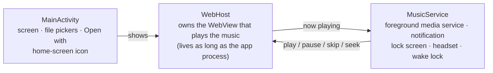

# Developing B-Side

How to build B-Side, publish a release, and how the pieces fit together. For using B-Side, see the
[README](../README.md).

## Build

### Web
```bash
python3 web/build.py        # web/app.html + fonts.css + skins/ + skins.js + icons.js → web/index.html and docs/index.html
```
Edit `web/app.html` (the player), `web/skins/*.css` and `web/skins.js` (the game styles), `web/icons.js` (the app icons)
or `web/fonts.css` (style fonts), then rebuild. `docs/index.html` is the copy GitHub Pages serves (deploy from the `docs`
folder of `main`); it's at https://tymonbitesthedust.github.io/B-Side/ and is where installed Android apps get updates.

### Android
B-Side builds **without Gradle or Android Studio**. You need:

- **JDK 17** or newer, and **Python 3**
- A folder of tools (set `TOOLS` to its path):
  - `aapt2`, `lib/d8.jar` → `d8.jar` and `lib/apksigner.jar` → `apksigner.jar` from Android SDK **build-tools 34**
  - `android.jar` from the Android SDK **platforms/android-34**
  - `ecj.jar`: the Eclipse Java compiler (`org.eclipse.jdt:ecj` on Maven Central)
- For regenerating launcher icons only: **Playwright** with Chromium, and **Pillow**

```bash
python3 web/build.py                 # 1. build the player
python3 android/gen_icons.py         # 2. only after changing web/icons.js (generated icons are committed)
export TOOLS=/path/to/tools
export KS_PASS='your-key-password'
android/build.sh                     # 3. → android/build/B-Side.apk
```

The first build creates a signing key at `android/bside-release.jks` if there isn't one. **Keep that key private and
back it up.** It is excluded by `.gitignore`, and every update must be signed with the same key to install over an
existing copy of B-Side.

## Release

The player's version lives in three `<meta>` tags at the top of `web/app.html`:

| Tag | What it means | When to change it |
|---|---|---|
| `bside-version` | The version shown in *Settings → About* | Every release |
| `bside-build` | A number that goes up with every release | Every release; installed apps update to a page with a higher build |
| `bside-native` | The oldest app `versionCode` this page works with | When the page needs something new from the Android part |

- **Player-only change:** raise `bside-version` and `bside-build`, run `python3 web/build.py`, and merge to `main`.
  GitHub Pages publishes `docs/index.html`, and phones pick it up the next time B-Side opens.
- **Android change:** also raise `versionCode` / `versionName` in `android/AndroidManifest.xml` and `android/build.sh`,
  set `bside-native` to the new `versionCode` if the page depends on it, and publish a new APK.
- Attach `android/build/B-Side.apk` and `web/index.html` (renamed `B-Side.html`) to the GitHub release.

## How it works

The whole player is one web page. Audio plays through an HTML `<audio>` element, routed through Web Audio for the
equaliser and volume levelling. To measure a song without loudness tags, B-Side decodes it once with an
`OfflineAudioContext` and applies the ITU-R BS.1770 K-weighting with 400 ms gated blocks; each song's level is then set
by one gain node. Tags are parsed in JavaScript with no libraries: ID3v1 and ID3v2.2–2.4, Vorbis comments (FLAC, Ogg,
Opus), MP4 metadata and RIFF INFO; loudness from `REPLAYGAIN_*`, Opus `R128_*_GAIN` or iTunes `iTunNORM`. The library
and copied song files live in IndexedDB, settings in `localStorage`.

Spotify import uses the Web API with Authorization Code + PKCE and the Redirect URI `http://127.0.0.1:43821/callback`
on every device: the Android app listens there during a sign-in; in a browser the user pastes that address back. Songs
are matched to the library by title (ignoring "(feat. …)", "- Remastered", brackets and accents) plus artist, album or
length.

The Android app is a small native shell:



- **`WebHost`** owns the WebView at process level rather than inside the screen. Closing B-Side, swiping it away or
  Android recycling the screen only detaches the view, so a song that's playing keeps playing. When nothing is
  playing and no screen is open, the player is freed.
- **`MusicService`** is a `mediaPlayback` foreground service. It mirrors the player into a `MediaSession` and
  notification, holds a wake lock while music plays, and pauses when headphones are unplugged. After a pause it stays
  in the foreground for 45 minutes.
- **`MediaButtonReceiver`** is registered with the media session, so Android keeps sending Play from cars and headsets
  to B-Side after it's closed; it wakes the player without a screen and resumes the last song.
- **`WebUpdater`** checks the website for a newer player page when the page asks (at most every half hour), keeps it in
  the app's files and serves it from the same app address on the next start, so stored data carries over. It never
  moves to an older build or one needing a newer app, and sets aside a page that fails to start three times.
- **`LoopbackLogin`** listens on `127.0.0.1:43821` only while a Spotify sign-in is waiting and passes the code to the
  page.
- **`MainActivity`** serves the page at `https://appassets.androidplatform.net/`, handles the Storage Access Framework
  pickers and "Open with", and switches the home-screen icon between 16 `<activity-alias>` entries.

## Project structure
```
b-side/
├── web/
│   ├── app.html          the player: markup, base styles and code
│   ├── skins/            one CSS file per game style, every rule scoped to [data-skin="…"]
│   ├── skins.js          style-only pieces: cut-out letters, star field, ribbon, page changes
│   ├── icons.js          app icon generator (tab icon, settings previews, launcher icons)
│   ├── fonts.css         display fonts for the styles (embedded, works offline)
│   ├── build.py          builds the single-file player
│   └── index.html        built player, ready to open or ship
├── android/
│   ├── AndroidManifest.xml
│   ├── src/app/bside/music/
│   │   ├── MainActivity.java
│   │   ├── WebHost.java
│   │   ├── WebUpdater.java
│   │   ├── MusicService.java
│   │   ├── MediaButtonReceiver.java
│   │   └── LoopbackLogin.java
│   ├── res/              hand-made resources (strings, theme, notification icons)
│   ├── res-gen/          launcher icons generated by gen_icons.py
│   ├── gen_icons.py
│   ├── zipalign.py
│   └── build.sh
└── docs/
    ├── index.html        the online copy (GitHub Pages), written by web/build.py
    ├── STYLES.md         the style sheet for each game style
    ├── DEVELOPING.md     this file
    └── screenshots/
```
