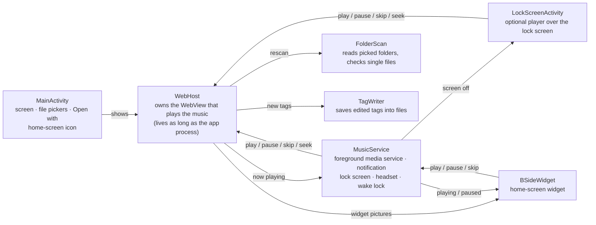

# Developing B-Side

How to build B-Side, publish a release, and how the pieces fit together. For using B-Side, see the
[README](../README.md).

## Build

### Web
```bash
python3 web/build.py        # web/app.html + fonts.css + skins/ + skins.js + icons.js + lock.js → web/index.html and docs/index.html
```
Edit `web/app.html` (the player), `web/skins/*.css` and `web/skins.js` (the game styles), `web/lock.js` (the lock screen player), `web/icons.js` (the app icons)
or `web/fonts.css` (style fonts), then rebuild. `docs/index.html` is the copy GitHub Pages serves (deploy from the `docs`
folder of `main`); it's at https://tymonbitesthedust.github.io/B-Side/ and is where installed Android apps get updates.

### Android
B-Side builds **without Gradle or Android Studio**. You need:

- **JDK 17** or newer, and **Python 3**
- A folder of tools (set `TOOLS` to its path):
  - `aapt2`, `lib/d8.jar` → `d8.jar` and `lib/apksigner.jar` → `apksigner.jar` from Android SDK **build-tools 34**
  - `android.jar` from the Android SDK **platforms/android-34**
  - `ecj.jar`: the Eclipse Java compiler (`org.eclipse.jdt:ecj` on Maven Central)
- For regenerating launcher icons only: **Playwright** with Chromium, and **Pillow**

```bash
python3 web/build.py                 # 1. build the player
python3 android/gen_icons.py         # 2. only after changing web/icons.js (generated icons are committed)
export TOOLS=/path/to/tools
export KS_PASS='your-key-password'
android/build.sh                     # 3. → android/build/B-Side.apk
```

The first build creates a signing key at `android/bside-release.jks` if there isn't one. **Keep that key private and
back it up.** It is excluded by `.gitignore`, and every update must be signed with the same key to install over an
existing copy of B-Side.

Add `TEST_PACKAGE=app.bside.music.test` to build **B-Side Test** instead: the same app under another package name,
which installs next to B-Side rather than over it, so you can try a change without touching your library.

### Build on GitHub
`.github/workflows/build.yml` builds both files on GitHub's machines, which already have the Android tools, on every
pull request and every push to `main`. The files are on the run's page under **Artifacts**.

To sign them with the release key, add two repository secrets once (**Settings → Secrets and variables → Actions →
New repository secret**):

| Secret | Value |
|---|---|
| `BSIDE_KEYSTORE` | `android/bside-release.jks` as base64 |
| `BSIDE_KS_PASS` | its password |

To get the base64, run this in the folder with the key:

```powershell
[Convert]::ToBase64String([IO.File]::ReadAllBytes("$PWD\bside-release.jks")) | Set-Clipboard   # Windows
```
```bash
base64 -w0 bside-release.jks        # Linux (on a Mac: base64 -i bside-release.jks)
```

The workflow checks that the APK's certificate matches `RELEASE_CERT_SHA256` in the workflow, and fails if it doesn't.
Since 1.10.2 that's the 1.10 key (made on 19 November 2026); 1.9.6 and older were signed with the original key, and
the 1.10.0 APK on GitHub with a third key that is no longer used. Pushing a `V…` tag attaches both files to the
release you drafted for that tag, keeping your notes, or makes a new draft if there isn't one.
Without the secrets it builds B-Side Test instead, so a build can't be mistaken for a release.

## Release

The player's version lives in three `<meta>` tags at the top of `web/app.html`:

| Tag | What it means | When to change it |
|---|---|---|
| `bside-version` | The version shown in *Settings → About* | Every release |
| `bside-build` | A number that goes up with every release | Every release; installed apps update to a page with a higher build |
| `bside-native` | The oldest app `versionCode` this page works with | When the page needs something new from the Android part |

Every release also adds one short line at the top of `HISTORY` in `web/app.html`: that's the update history in
*Settings → About B-Side*.

- **Player-only change:** raise `bside-version` and `bside-build`, run `python3 web/build.py`, and merge to `main`.
  GitHub Pages publishes `docs/index.html`, and phones pick it up the next time B-Side opens.
- **Android change:** also raise `versionCode` / `versionName` in `android/AndroidManifest.xml` and `android/build.sh`,
  set `bside-native` to the new `versionCode` if the page depends on it, and publish a new APK.
- Attach `android/build/B-Side.apk` and `web/index.html` (renamed `B-Side.html`) to the GitHub release. With the
  secrets above, pushing a tag such as `V1.10.0` does this for you: the workflow drafts the release with both files
  attached, and you publish it.

## How it works

The whole player is one web page. Audio plays through an HTML `<audio>` element, routed through Web Audio for the
equaliser, bass and treble (a 100 Hz low shelf and an 8 kHz high shelf), stereo expand (mid/side: the side signal is
raised up to 2.2×, after making mono input stereo) and volume levelling. The chain is only built once one of them is
used; a pre-gain leaves headroom for boosts. To measure a song without loudness tags, B-Side decodes it once with an
`OfflineAudioContext` and applies the ITU-R BS.1770 K-weighting with 400 ms gated blocks; each song's level is then set
by one gain node. Tags are parsed in JavaScript with no libraries: ID3v1 and ID3v2.2–2.4, Vorbis comments (FLAC, Ogg,
Opus), MP4 metadata and RIFF INFO; loudness from `REPLAYGAIN_*`, Opus `R128_*_GAIN` or iTunes `iTunNORM`. The library
and copied song files live in IndexedDB, settings in `localStorage`.

Playback runs on two `<audio>` elements, *decks*, so the next song can be loaded and started on time. About 20 s
before a song ends the next one is loaded on the other deck; 12 s before, the hand-over is planned on the
`AudioContext` clock (a `ConstantSourceNode` whose `onended` fires even when the page is in the background and its
timers are throttled). Gapless starts the next deck as the first one ends, a little early by the delay that deck
was measured to need; a crossfade ramps both decks' fade gains with equal-power curves (`setValueCurveAtTime`). Each
deck has its own level and fade gain before the shared chain. Seeking, pausing, changing speed or the queue cancels
the plan, and it's made again.

The one-time decode that measures loudness also stores each song's *shape*: where the sound starts and ends and any
quiet stretch of 2.5 s or more inside it (below −48 dBFS), for *Skip silence*, and 240 peak values for the waveform
seekbar (`t.wave`, 6 bits each). The waveform is drawn on a canvas under the seekbar with each style's own bars
(`WAVE_LOOK`).

Listening history is a list of `[minute, song id, seconds]` in `localStorage` (`bside:history`); a song counts after
30 seconds or half of it. Stats, the recap and Lost memories are worked out from it when they're opened.

The tag editor writes new ID3v2.3/2.4 or FLAC metadata in JavaScript: the frames and blocks it doesn't edit are kept
byte for byte, and padding is used so the file keeps its size when it can. The new start of the file is read back
before anything is written, and only the start is replaced; the music after it is never touched. In Chrome and Edge
it's written with the folder's `FileSystemFileHandle`; on Android by `TagWriter` (below). Song ids are made from name
and size, so a file whose size changes keeps its id through `bside:alias`.

The lock screen player is the same page in lock mode: `web/lock.js` runs first and, when it's opened with the
`BSideLock` bridge or as `#lock` / `#lockpreview`, it keeps only the icon sprite and draws the Now Playing screen's markup
with a clock, so every style dresses it exactly as it dresses the app. The player's own script then returns at once
(`window.__bsideLock`). The preview in *Settings → Lock screen* is that page in an iframe (`?lock=preview#lockpreview`),
fed by `postMessage`. Persona 5's cut-out letters live in `web/ransom.js`, shared by both.

Folders are remembered in `localStorage` (`bside:folders`), and each song records the folder it came from (`src`) or,
on Android, the single file that was picked (`uri`). A rescan lists each folder again: on Android through the app's
lasting folder access, in Chrome and Edge through the folder's `FileSystemDirectoryHandle` (kept in a separate IndexedDB
database, `bside-folders`), elsewhere by having the folder chosen again. Songs on disk are matched by name and size, or by
folder path and name. Songs no longer there are removed, except from folders that couldn't be read whole; a folder that
reads as empty, or one that would lose more than half its songs, asks first (or waits, if nobody's looking). Songs you
remove yourself go on the folder's skip list. Folders picked before 1.10 are adopted from Android's list of granted
folders: their songs are linked and whatever was in the folder but not in the library is noted, so only later additions
are imported.

Spotify import uses the Web API with Authorization Code + PKCE and the Redirect URI `http://127.0.0.1:43821/callback`
on every device: the Android app listens there during a sign-in; in a browser the user pastes that address back. Songs
are matched to the library by title (ignoring "(feat. …)", "- Remastered", brackets and accents) plus artist, album or
length.

The Android app is a small native shell:



- **`WebHost`** owns the WebView at process level rather than inside the screen. Closing B-Side, swiping it away or
  Android recycling the screen only detaches the view, so a song that's playing keeps playing. When nothing is
  playing and no screen is open, the player is freed.
- **`MusicService`** is a `mediaPlayback` foreground service. It mirrors the player into a `MediaSession` and
  notification, holds a wake lock while music plays, and pauses when headphones are unplugged. After a pause it stays
  in the foreground for 45 minutes.
- **`MediaButtonReceiver`** is registered with the media session, so Android keeps sending Play from cars and headsets
  to B-Side after it's closed; it wakes the player without a screen and resumes the last song.
- **`WebUpdater`** checks the website for a newer player page when the page asks (at most every half hour), keeps it in
  the app's files and serves it from the same app address on the next start, so stored data carries over. It never
  moves to an older build or one needing a newer app, and sets aside a page that fails to start three times.
- **`LoopbackLogin`** listens on `127.0.0.1:43821` only while a Spotify sign-in is waiting and passes the code to the
  page.
- **`FolderScan`** reads a folder picked with `ACTION_OPEN_DOCUMENT_TREE` (songs, `cover`/`folder` pictures and `.lrc`
  files, up to 12 levels and 20,000 files). It's used when a folder is added and again when the page asks for a rescan
  (`scanTree`): the files found are served at `/__scan/<key>` so the page can add the new ones. A walk that couldn't read
  every subfolder is reported as partial, and the page then removes nothing from that folder. `checkFiles` looks up songs
  picked one by one; the page only believes "no such file" when the same storage answered for other files just then.
- **`LockScreenActivity`** is the optional lock screen player. `MusicService` listens for `SCREEN_OFF` and, while music
  plays (or for 10 minutes after a pause, never during a call), opens it with `showWhenLocked`. It shows the player's own
  page in lock mode (`web/lock.js`) in a WebView of its own, on its own origin (`lock.appassets.androidplatform.net`), so it
  can't reach the library; nothing but the page and the cover (`/__cover/<key>`) loads. Through the `BSideLock` bridge it
  gets the song, the synced lyrics and the look chosen in *Settings → Lock screen* (sent by the page with `setLockLook`), and
  sends play/pause/skip/seek/favourite back. Swiping up calls `requestDismissKeyguard`; it closes itself on `USER_PRESENT` (unless
  *Stay until I swipe it away* is on), when there's no lock screen to cover, or when something else covers it on an
  unlocked phone. Every screen-off asks for it again, so one left out of sight is brought back to the front
  (`onNewIntent`) instead of blocking the next; an unlock Android never answers is let go after 12 seconds. A start
  Android refuses is noticed (nothing opened within 3 seconds) and counted, and *Settings → Lock screen* then says
  which permission to check. The native screen shows if the page hasn't said it has drawn (`BSideLock.ready()`)
  within 8 seconds. If no WebView can be made, a plain native screen stands in. Android 10+ only
  allows the start from the background with `SYSTEM_ALERT_WINDOW` ("Display over other apps"), which the page asks for
  when the setting is turned on. The page sends a 720 px cover for it while it's on. The lock page is read with
  `WebUpdater.peek`, which doesn't count as a page start.
- **`BSideWidget`** is the home-screen widget. The page draws it in the chosen style twice, one picture with pause and
  one with play (`widgetPictures` in `app.html`, at the size and density `widgetInfo` reports), and sends both with
  `setWidget`; they're kept in the app's files. `MusicService` shows the one that matches when playing starts or stops,
  so it's right even after B-Side closes. The buttons are transparent views over the picture, laid out in
  `res/layout/widget.xml` where the page draws them (8 dp from the right, then 44, 52 and 44 dp). They broadcast to the
  widget, which passes them on like a headset button (`MusicService.resume`). A new or resized widget asks the page to
  draw again (`bsideWidgetDraw`). Before the first picture, a plain layout with the notification icons shows.
- **`TagWriter`** saves the tag editor's changes into a file (`writeHead`). The page sends the new start of the file and
  how long the old one was; a song inside a picked folder is found by its folder path and name. Same size: the bytes
  are written in place through `openFileDescriptor("rw")` and checked. Otherwise the rest of the file is copied to the
  cache, the new start and the rest are written back, and the file is put back as it was if anything fails. Since
  1.11.0 the pickers ask for write access and keep it (`takePersistableUriPermission` with read and write);
  `canWrite` tells the page whether a song or folder has it.
- **`MainActivity`** serves the page at `https://appassets.androidplatform.net/`, handles the Storage Access Framework
  pickers and "Open with", and switches the home-screen icon between 16 `<activity-alias>` entries.

## Project structure
```
b-side/
├── .github/workflows/
│   └── build.yml         builds B-Side.apk and B-Side.html on GitHub
├── web/
│   ├── app.html          the player: markup, base styles and code
│   ├── skins/            one CSS file per game style, every rule scoped to [data-skin="…"]
│   ├── skins.js          style-only pieces: star field, ribbon, page changes
│   ├── ransom.js         Persona 5 cut-out letters (player and lock screen)
│   ├── lock.js           the lock screen player: this page in lock mode
│   ├── icons.js          app icon generator (tab icon, settings previews, launcher icons)
│   ├── fonts.css         display fonts for the styles (embedded, works offline)
│   ├── build.py          builds the single-file player
│   └── index.html        built player, ready to open or ship
├── android/
│   ├── AndroidManifest.xml
│   ├── src/app/bside/music/
│   │   ├── MainActivity.java
│   │   ├── WebHost.java
│   │   ├── WebUpdater.java
│   │   ├── MusicService.java
│   │   ├── MediaButtonReceiver.java
│   │   ├── LockScreenActivity.java
│   │   ├── FolderScan.java
│   │   ├── BSideWidget.java
│   │   ├── TagWriter.java
│   │   └── LoopbackLogin.java
│   ├── res/              hand-made resources (strings, theme, notification icons)
│   ├── res-gen/          launcher icons generated by gen_icons.py
│   ├── gen_icons.py
│   ├── zipalign.py
│   └── build.sh
└── docs/
    ├── index.html        the online copy (GitHub Pages), written by web/build.py
    ├── STYLES.md         the style sheet for each game style
    ├── DEVELOPING.md     this file
    └── screenshots/
```
